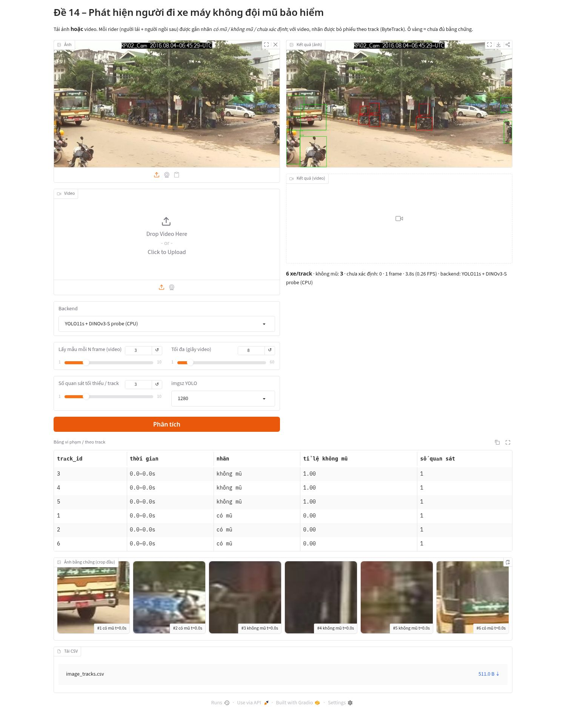
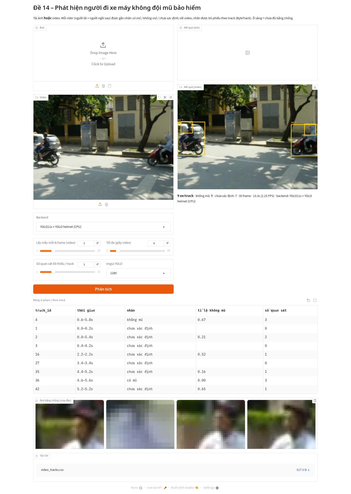

# Đề 14 – Phát hiện người đi xe máy không đội mũ bảo hiểm (SAM 3.1 + DINOv3)

Pipeline: **SAM 3.1** (prompt văn bản `motorcycle` / `person` / `head`) → ghép rider–xe (người lái + người ngồi sau) → **ByteTrack** → crop đầu → **DINOv3 ViT-S/16 + linear probe** (hoặc YOLO helmet) → bỏ phiếu theo track → `không đội mũ` / `có đội mũ` / **`chưa xác định`**. Đầu ra gồm CSV track (kèm mốc thời gian), CSV các quan sát, ảnh crop bằng chứng `evidence/<video>_track<ID>_t<giây>s_p<prob>.jpg` và video có chú thích.

## Kết quả đo (CPU box dùng chung 8 vCPU, load avg 25–80; đo ngày 23/10/2026)
Dữ liệu: HELMET (Myanmar, Lin & Siebert 2020, CC-BY 4.0 theo OSF). Annotation lấy từ Kaggle mirror `hozngvan/helmet-detection`; frame 640×640 (ảnh gốc 1920×1080 đã bị co về 640×640) lấy từ HF `eiglesiasr/nohelmetnet`. Train và test tách **theo clip**, dùng `data_split.csv` chính thức.

### A. Phân loại crop đầu (618 crop từ 10 clip *training*, 249 không mũ; GroupKFold 5 theo clip)
| Phương pháp | Precision (không mũ) | Recall | F1 | AUC | Coverage |
|---|---|---|---|---|---|
| **DINOv3 ViT-S/16 + linear probe** | **0.579** | **0.558** | **0.569** | **0.692** | 100% |
| DINOv3 ViT-S/16 + kNN (k=7) | 0.433 | 0.349 | 0.387 | 0.549 | 100% |
| YOLO11s helmet (nnsohamnn), chạy trên crop | 0.396 | 0.492 | 0.439 | 0.579 | 55.2% |
Tốc độ embedding DINOv3-S trên CPU (box quá tải): 1.9 crop/s.

### B. SAM 3.1 trên CPU (đo thật)
- Đã tải checkpoint gated `facebook/sam3.1/sam3.1_multiplex.pt` (cần HF_TOKEN). Phần detector nạp vào image model: thiếu 4 key, thừa 36 key (lớp `convs.3`/`interactive_convs`, không thuộc nhánh detector).
- Mỗi frame chạy 3 prompt mất **91–173 s** (mã hoá ảnh ≈ 12.6 s, mỗi prompt ≈ 30 s), tức **≈ 0.007–0.011 FPS**. Trên CPU có rò bộ nhớ (lên tới ≈ 7 GB RSS rồi bị OOM-kill), nên phải chạy 1 tiến trình cho mỗi frame (`src/run_sam31_cpu_sample.sh`).
- Đã cache 20 frame (Bago_urban_3, 2 fps). Ví dụ frame 001: 14 motorcycle, 11 person, 8 head.

### C. Đánh giá theo track trên GPU (Kaggle kernel v2, 2× Tesla T4, chạy xong 24/10/2026)
Kernel [`holilihu/de14-helmet-sam31-dinov3`](https://www.kaggle.com/code/holilihu/de14-helmet-sam31-dinov3). 7 clip test HELMET, stride 2, 50 frame/clip (350 frame), 51 GT track, trong đó 19 track vi phạm. Số liệu gốc ở `docs/results/kaggle_v2/*.json`.

| Phương pháp | Precision (track khớp GT) | Precision (tính cả track không khớp GT) | Recall (trên 19 GT vi phạm) | Recall (track đã quyết định) | Tỷ lệ chưa xác định | Coverage | FPS |
|---|---|---|---|---|---|---|---|
| B0: YOLO helmet theo từng frame | lỗi (`TypeError` tensor CUDA sang numpy, đã sửa bằng `.cpu()`, chưa chạy lại) | | | | | | |
| B1: YOLO11s + ByteTrack + YOLO helmet | 0.455 | 0.313 | 0.263 | 0.556 | 0.429 | 0.686 | 2.27 |
| B1': YOLO11s + ByteTrack + DINOv3-B probe | 0.786 | 0.268 | 0.579 | 0.917 | 0.200 | 0.686 | 1.98 |
| Core: SAM 3.1 + ByteTrack + YOLO helmet | 0.250 | 0.083 | 0.053 | 0.125 | 0.500 | 0.745 | 9.50* |
| **Core: SAM 3.1 + ByteTrack + DINOv3-B probe** | **1.000** (11 TP, 0 FP) | 0.212 (41 track không khớp GT) | **0.579** | 0.846 | **0.184** | **0.745** | 6.09* |

\* FPS của Core chỉ tính bước tracking + phân loại, vì SAM 3.1 đã cache trước. Bản thân SAM 3.1 (4 prompt `motorcycle,person,head,helmet`, fp32, T4, không Flash Attention) mất khoảng 259 s cho mỗi 50 frame, tức **≈ 0.19 FPS**, nên FPS đầu-cuối thật của Core ≈ 0.19.

Điểm yếu chính: precision giảm mạnh khi tính các track dự đoán không khớp GT (xe đỗ, xe ở xa, hoặc xe mà HELMET không gán nhãn). Cần kiểm tra thủ công một mẫu track này trước khi coi là FP thật.

Linear probe theo crop (2809 crop, 725 không mũ, 39 clip, CV theo clip):

| Backbone | Precision | Recall | F1 | AUC | Tốc độ embed (T4) |
|---|---|---|---|---|---|
| DINOv3 ViT-S/16 | 0.648 | 0.806 | 0.718 | 0.903 | 205.7 crop/s |
| DINOv3 ViT-B/16 | 0.652 | 0.801 | 0.719 | 0.911 | 78.5 crop/s |
| DINOv3 ViT-L/16 | chưa xác định: không tải được trọng số (OSError, không có trong dataset riêng và không có HF_TOKEN), kernel tự fallback sang DINOv2-small nên số đó không tính | | | | |
| YOLO helmet trên crop | 0.301 | 0.508 | 0.378 | 0.658 | coverage 50% |

## Chạy
```bash
python -m venv .venv && . .venv/bin/activate && pip install -r requirements.txt   # + torch CPU/GPU
git clone https://github.com/facebookresearch/sam3 third_party_sam3 && (cd third_party_sam3 && git apply ../patches/sam3_cpu.patch && pip install --no-deps -e .)
set -a; source /workspace/tgmt/.env; set +a        # HF_TOKEN, KAGGLE_API_TOKEN — không commit
bash scripts/get_data.sh
python src/build_head_crops.py && python src/train_probe.py
python src/eval_helmet.py --method b0
python src/eval_helmet.py --method b1 --detector sam31 --classifier dino
python src/run_video.py <video_or_dir> --detector sam31 --classifier dino --stride 3 --out outputs/demo
```
GPU: `notebooks/de14_colab_kaggle.ipynb` (Colab/Kaggle T4, secrets qua Colab/Kaggle Secrets).

## Ước lượng trên T4 (CHƯA ĐO)
- SAM 3.1 có 848M tham số. Chạy fp16 cần khoảng 2–3 GB VRAM trọng số, tổng khoảng 6–8 GB ở độ phân giải 1008; vừa T4 16 GB nếu batch = 1.
- T4 không có FA3 và không hỗ trợ bf16 phần cứng, nên dùng fp16 hoặc `use_fa3=False`. Ước lượng thô: 1–3 FPS với 3 prompt.
- DINOv3-S: khoảng 200–500 crop/s.

## Công nghệ
| Thành phần | Model / phiên bản | Thư viện | License | Lý do | Link |
|---|---|---|---|---|---|
| Phát hiện + phân đoạn theo text (lõi) | SAM 3.1 (`sam3.1_multiplex.pt`, phát hành 27/03/2026) | `sam3` (repo Meta) + patch CPU | SAM License (gated) | Open-vocabulary, có head/person/motorcycle, tracking multiplex | https://github.com/facebookresearch/sam3 · https://huggingface.co/facebook/sam3.1 |
| Embedding đầu (lõi) | DINOv3 ViT-S/16 LVD-1689M | transformers 5.20.2 | DINOv3 License (gated) | Đặc trưng tự giám sát mạnh, probe tuyến tính rẻ | https://github.com/facebookresearch/dinov3 · https://huggingface.co/facebook/dinov3-vits16-pretrain-lvd1689m |
| Probe | Logistic regression / kNN | scikit-learn | BSD | Không cần fine-tune GPU | |
| Tracking | ByteTrack | ultralytics 8.4.184 | AGPL-3.0 | Chuẩn MOT, dùng cho cả SAM và YOLO | https://github.com/ifzhang/ByteTrack |
| Baseline detector | YOLO11s COCO | ultralytics 8.4.184 | AGPL-3.0 | Baseline nhanh | https://github.com/ultralytics/ultralytics |
| Baseline helmet | YOLO11s helmet (nnsohamnn) | ultralytics | MIT | Pretrained helmet/không mũ | https://huggingface.co/nnsohamnn/helmet-detection-yolo11 |
| Dữ liệu | HELMET (Myanmar) | Kaggle API 2.2.5 | CC-BY 4.0 (OSF) / Kaggle ghi "Unknown" | Video + track, Đông Nam Á | https://osf.io/4pwj8/ · https://www.kaggle.com/datasets/hozngvan/helmet-detection · https://huggingface.co/datasets/eiglesiasr/nohelmetnet |
| Video demo | "Stratkruciĝo en Hanojo" | — | CC BY-SA 4.0 | Giao thông Hà Nội | https://commons.wikimedia.org/wiki/File:Stratkruci%C4%9Do_en_Hanojo.webm |
| Runtime | Python 3.13.5 (đề yêu cầu 3.12), torch 2.14.1+cpu | | | Box chỉ có CPU | |

### Giấy phép & trích dẫn dữ liệu HELMET
- Nguồn gốc: **HELMET dataset**, OSF https://osf.io/4pwj8/, giấy phép **CC-BY 4.0**.
- Bài báo gốc: H. Lin, J. D. Deng, D. Albers, F. W. Siebert, "Helmet Use Detection of Tracked Motorcycles Using CNN-Based Multi-Task Learning", *IEEE Access* 8, 2020. doi:10.1109/ACCESS.2020.3021357
- Kaggle `hozngvan/helmet-detection` và HF `eiglesiasr/nohelmetnet` (ảnh co về 640×640) **chỉ là bản sao (mirror)** do bên thứ ba tải lên. Trang Kaggle ghi license "Unknown", nên báo cáo dẫn license gốc CC-BY 4.0 từ OSF.

## Demo Gradio (`app.py`)
Có thể tải lên **ảnh hoặc video**. App phát hiện xe máy và rider (cả người lái lẫn người ngồi sau) rồi vẽ box: box đầu màu đỏ là không mũ, xanh là có mũ, vàng là chưa xác định. Với video, mỗi track được bỏ phiếu bằng ByteTrack. Kết quả gồm **bảng theo track** (track id, khoảng thời gian, nhãn, tỉ lệ không mũ, số quan sát), **gallery ảnh bằng chứng**, và **CSV** để tải về.

Backend:
- `YOLO11s + YOLO helmet (CPU)`: mặc định.
- `YOLO11s + DINOv3-S probe (CPU)`: cần `weights/dino_probe.joblib`, tạo bằng `src/train_probe.py`, và quyền truy cập DINOv3.
- `SAM 3.1 + DINOv3-S probe (GPU)`: cần checkpoint gated, lấy qua `HF_TOKEN` hoặc `SAM31_CKPT`.

```bash
# local (CPU)
. .venv/bin/activate && python app.py --port 7860          # mở http://localhost:7860
# Colab / Kaggle (GPU): sau khi cài theo notebook
python app.py --share                                       # in ra link public *.gradio.live
python scripts/screenshots.py http://127.0.0.1:7860         # chụp màn hình bằng Playwright (Chrome headless)
```
Kết quả chạy thật trên CPU của box ngày 24/10/2026:
- Ảnh HELMET Bago_urban_3 frame 001, phóng lại về 1920×1080, backend DINOv3-S: phát hiện 6 xe, gán 3 "không mũ" và 3 "có mũ", mất 3.4 s. GT của frame này chỉ có 1 xe với người lái có mũ, nên đây là **false positive**: phần lớn là xe đỗ, và đầu chỉ khoảng 10 px.
- Clip Hà Nội 6 s (640×480, CC BY-SA 4.0), backend YOLO helmet, lấy mỗi 3 frame (30 frame): phát hiện 9–10 track, 1 "không mũ", 7–9 "chưa xác định", tốc độ 2.3–6.1 FPS.



